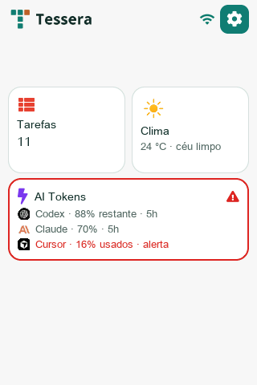
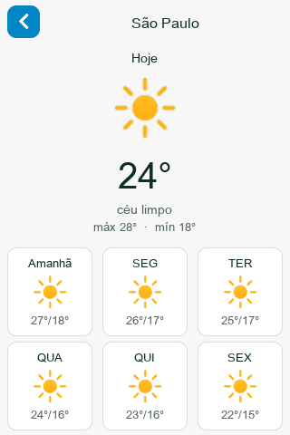
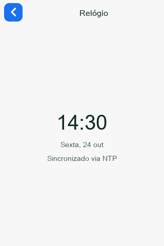
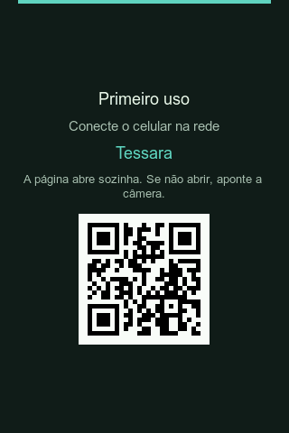

# Tessera

[](LICENSE)

Modular wall / desk panel for ESP32 (**JC3248W535**): widget home, per-widget detail, phone portal, and a Mac USB agent.

**MVP acceptance:** clock + weather + shell / Widget SDK / simulator / portal.  
Extras in-tree (Todoist, AI Tokens, screen rest, …) do not block MVP.

> Documentation language: **English** is the default. Portuguese mirrors live under [`docs/pt/`](docs/pt/).

## Screenshots

Portrait **320×480** from the host simulator (`make e2e` / `make sim`) and one on-device snap.

| Home | Weather | Clock |
| :---: | :---: | :---: |
|  |  |  |



*First-use / captive portal on the JC3248 after flash (when Wi‑Fi is not configured yet).*

## Quick start (no hardware)

```bash
# macOS — see docs/getting-started.md for Linux
brew install cmake ninja pkg-config sdl2 freetype python3

python3 -m venv .venv
.venv/bin/pip install -U platformio
.venv/bin/pio pkg install -e jc3248w535

make finish-host    # native tests + simulator E2E
make sim            # interactive SDL window (320×480)
```

Full environment setup (macOS + Linux): **[`docs/getting-started.md`](docs/getting-started.md)** · PT: [`docs/pt/getting-started.md`](docs/pt/getting-started.md)

## Repository layout

| Path | Role |
|---|---|
| `firmware/` | Device app (`components/`, `widgets/`, `boards/`) |
| `simulator/` | Same UI sources on host (LVGL9 + SDL2) + `verify_all` |
| `web/` | Portal HTML → PROGMEM embed |
| `agent/` | Mac USB agent (AI Tokens first capability) |
| `docs/` | Guides, ADRs, feature plans |
| `Makefile` | Finish gate (`make help`) |

More detail: [`docs/STRUCTURE.md`](docs/STRUCTURE.md) · architecture: [`docs/guides/architecture.md`](docs/guides/architecture.md)

## Finish gate

Every change that touches product code:

1. `make test` — PlatformIO `native` (Unity)
2. `make e2e` — simulator build + headless screenshots (`$SIM_OUT`)
3. `make flash` — only after 1–2 are green
4. `make device` — USB monitor / manual check on the panel

Shortcuts: `make finish-host` (CI / no board) · `make finish` (+ flash).  
See [`docs/guides/finish-gate.md`](docs/guides/finish-gate.md).

## Secrets

Do **not** commit `include/secrets.h`, `.pio/`, or `.venv/`.  
Optional seed: copy `include/secrets.example.h` → `include/secrets.h`. Normal path is portal / NVS.

## Contributing

See [`CONTRIBUTING.md`](CONTRIBUTING.md).

## License

Licensed under the [Apache License, Version 2.0](LICENSE). See also [`NOTICE`](NOTICE) for third-party attribution.

## Docs map

| Doc | Purpose |
|---|---|
| [Getting started](docs/getting-started.md) | macOS + Linux toolchain |
| [Architecture](docs/guides/architecture.md) | Layers + widget contract |
| [Widget authoring](docs/guides/widget-authoring.md) | New widget checklist |
| [Simulator](docs/guides/simulator.md) | Host harness (not a demo) |
| [Finish gate](docs/guides/finish-gate.md) | Required verification order |
| [docs/README.md](docs/README.md) | Full index |
